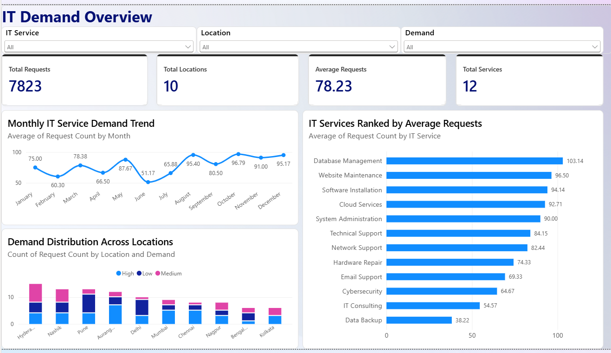
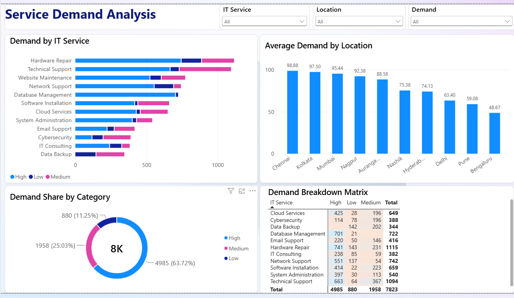
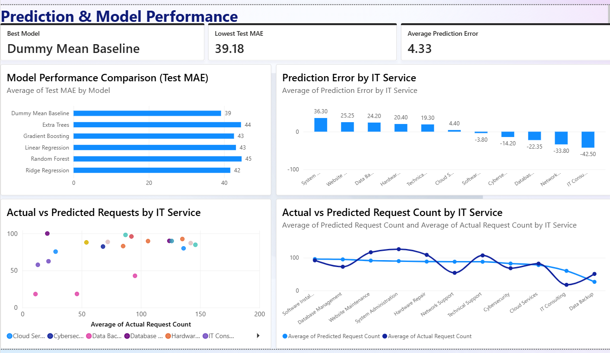

# IT Services Demand Prediction

## Project Overview
IT Services Demand Prediction is a project developed to analyze IT service request patterns and predict future demand using machine learning models. The project presents key insights through an interactive Power BI dashboard.

## Project Contributors
This project was collaboratively developed by:

1. **Gauri Rajiv Suryawanshi**
2. **Vaishnavi Ashok Mahangare**

Both contributors collaboratively worked on the development of **IT Services Demand Prediction**.

## Objectives
- Analyze IT service request demand.
- Identify demand trends across months and locations.
- Compare demand across different IT services.
- Evaluate machine learning models for demand prediction.
- Present insights through interactive visualizations.

## Tools and Technologies
- **Power BI** – Dashboard creation and data visualization
- **Python** – Data analysis and machine learning
- **Pandas** – Data processing
- **Scikit-learn** – Machine learning models

## Dashboard Pages

### 1. IT Demand Overview
Provides an overview of total requests, locations, services, monthly trends, and demand distribution.

### 2. Service Demand Analysis
Analyzes demand by IT service, location, category, and detailed breakdown.

### 3. Prediction & Model Performance
Compares machine learning models and visualizes actual versus predicted request counts and prediction errors.

## Machine Learning Models
The following models are compared:
- Dummy Mean Baseline
- Ridge Regression
- Gradient Boosting
- Linear Regression
- Extra Trees
- Random Forest

## Model Evaluation
Models are evaluated using Mean Absolute Error (MAE). The dashboard displays model comparisons and prediction errors to help assess performance.

## Key Highlights
- Interactive dashboard with three pages.
- Analysis of IT service demand across locations.
- Comparison of multiple machine learning models.
- Actual versus predicted demand visualization.

## Conclusion
This project helps understand IT service demand patterns and provides a visual approach to analyzing and evaluating demand predictions.

## Dashboard Screenshots

### 1. IT Demand Overview

### 2. Service Demand Analysis

### 3. Prediction & Model Performance

## Project Files

| File Name | Description |
|---|---|
| IT Services Demand Prediction.pbix | Interactive Power BI dashboard |
| it_service_demand_100_rows.csv | Main dataset used for demand analysis |
| IT_Demand_Analysis_Results.xlsx | Analysis results and model performance data |
| README.md | Project documentation |
